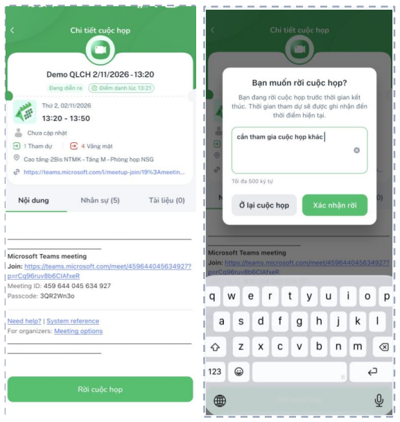

## Các bước thực hiện

:::steps
1. Nhấn nút **“Rời cuộc họp”** trên màn hình chi tiết cuộc họp.
2. Nhập lý do rời họp sớm vào popup hiển thị.
3. Nhấn **“Xác nhận”** để hoàn tất thao tác.
:::

:::success
Hệ thống ghi nhận thời điểm rời họp và lý do báo về sớm, phục vụ việc theo dõi thời lượng và tình trạng tham gia cuộc họp.
:::
