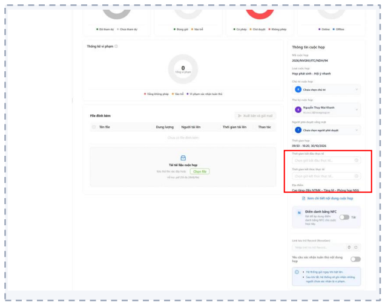

## Các bước thực hiện

:::steps
1. Truy cập màn hình **Chi tiết cuộc họp**.
2. Nhập **Thời gian bắt đầu thực tế** và **Thời gian kết thúc thực tế**.
3. Hệ thống đánh giá lại tình trạng tham gia của người tham gia.
:::

:::note
Khi họp bắt đầu trễ so với lịch, người điểm danh theo giờ dự kiến có thể bị ghi nhận **Vào trễ**; sau khi cập nhật giờ thực tế, hệ thống sẽ xét lại.
:::
