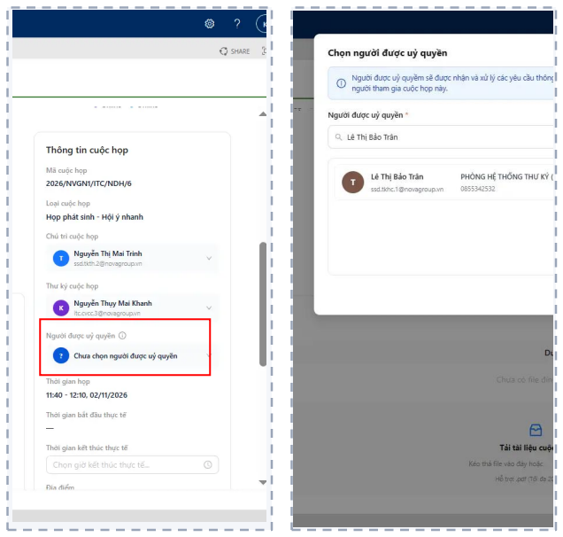

## Các bước thực hiện

:::steps
1. Mở **Chi tiết cuộc họp**.
2. Tại trường **“Người được ủy quyền”**.
3. Chọn người được ủy quyền.
4. Lưu thông tin.
:::

## Kết quả

Người được ủy quyền sẽ thực hiện các công việc:

- [Phê duyệt vắng mặt](/docs/phe-duyet-vang-mat-qua-teams) khi người tham gia gửi báo vắng.
- [Duyệt biên bản họp](/docs/phe-duyet-bien-ban-hop).
- Xác nhận công việc chỉ định trong cuộc họp đã hoàn thành trên E-Office.

:::tip
Đối với cuộc họp thông thường, “Người chủ trì” và “Người phê duyệt vắng mặt” là cùng một người. Xem thêm [Câu hỏi thường gặp](/docs/faq#phe-duyet-vang-mat).
:::
