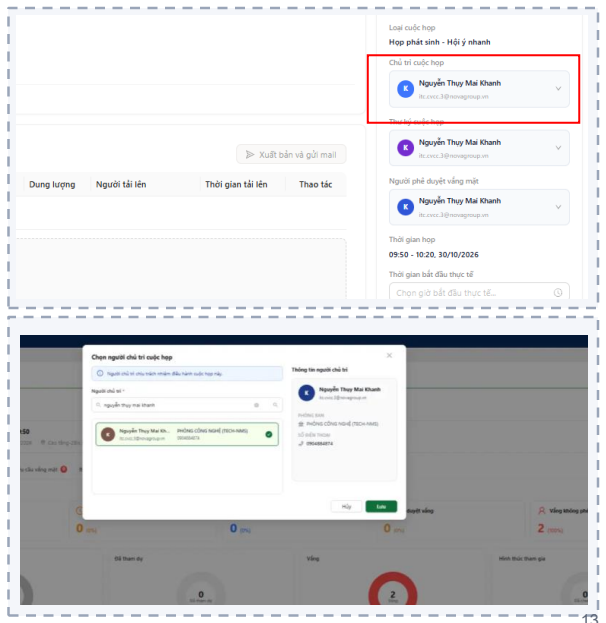

## Các bước thực hiện

:::steps
1. Mở **Chi tiết cuộc họp**.
2. Tại trường **“Chủ trì cuộc họp”**.
3. Chọn người chủ trì.
4. Lưu thông tin.
:::

## Kết quả

- Tự động điền thông tin chủ trì khi xuất Biên bản theo template.
- Xác định người theo dõi và xác nhận hoàn thành công việc trên E-Office.
