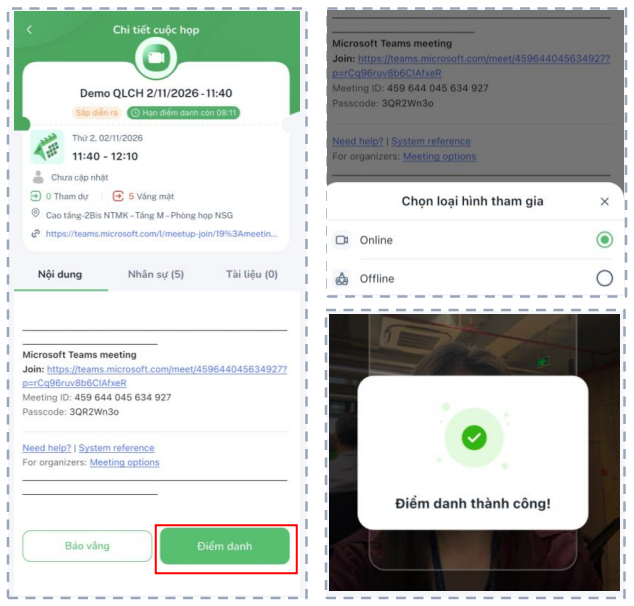

## Các bước thực hiện

:::steps
1. Truy cập **Chi tiết cuộc họp** và bấm **“Điểm danh”**.
2. Chọn hình thức tham gia (**Online**/**Offline**).
3. Thực hiện quét **Face ID**.
:::

:::success
Hệ thống ghi nhận thời gian điểm danh thực tế và cập nhật trạng thái tham gia.
:::

:::hidden
:::tip
Nếu cuộc họp yêu cầu [điểm danh bằng NFC](/docs/yeu-cau-diem-danh-nfc), chọn hình thức **“Trực tiếp (Offline)”** và quét NFC tại phòng họp.
:::
:::
