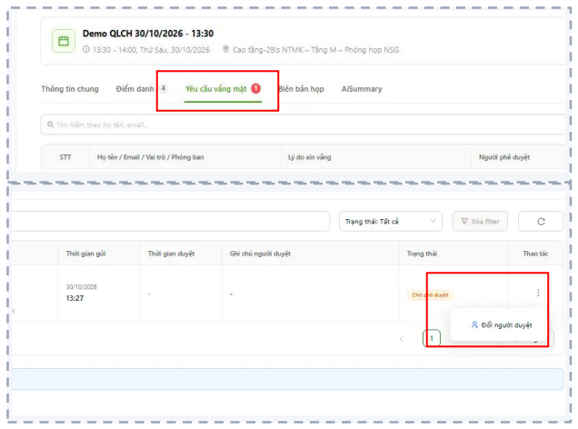

## Các bước thực hiện

:::steps
1. Tại danh sách **“Yêu cầu vắng mặt”**, chọn yêu cầu cần thay đổi.
2. Chọn **“Đổi người duyệt”**.
3. Chọn người phê duyệt mới và xác nhận.
:::

:::success
Yêu cầu chuyển đến người duyệt mới; các yêu cầu khác không bị ảnh hưởng.
:::

:::note
Chỉ đổi được khi yêu cầu ở trạng thái **“Chờ phê duyệt”** hoặc **“Chờ chỉ định người duyệt”**.
:::
