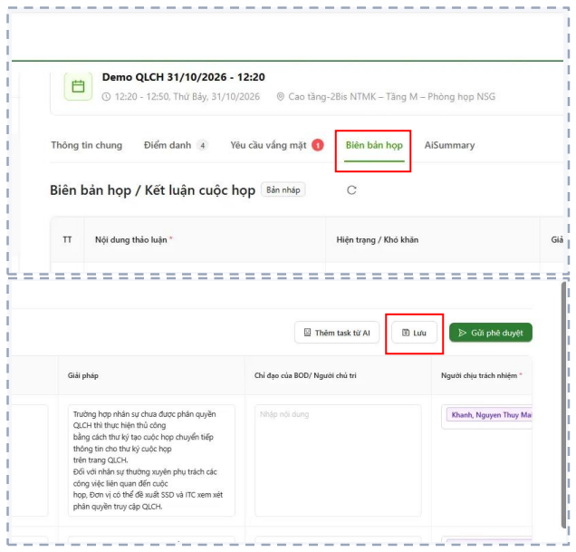

## Các bước thực hiện

:::steps
1. Mở tab **“Biên bản họp”**.
2. Nhập nội dung trao đổi/kết luận và thông tin công việc.
3. Nhập các thông tin E-Office nếu có.
4. Bấm **Lưu** để lưu lại các nội dung đã nhập.
:::

:::note
Bấm **Lưu** chỉ lưu nội dung; công việc được đồng bộ lên E-Office **sau khi Biên bản họp được duyệt**. Tiếp theo: [Gửi duyệt biên bản họp](/docs/gui-duyet-bien-ban-hop).
:::
