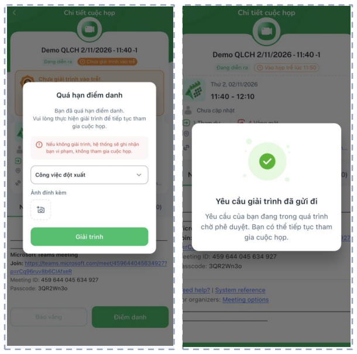

## Các bước thực hiện

:::steps
1. Khi điểm danh trễ, hệ thống hiển thị popup **“Quá hạn điểm danh”** và yêu cầu giải trình.
2. Chọn lý do có sẵn hoặc điền lý do khác.
3. Chọn **“Giải trình”**.
:::

:::success
Hệ thống ghi nhận thông tin để người mời họp theo dõi.
:::
