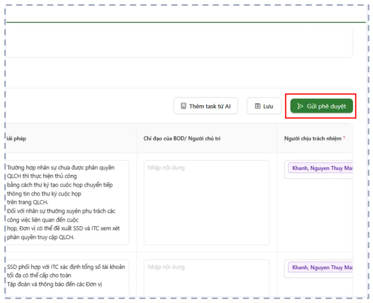

## Các bước thực hiện

:::steps
1. Truy cập **Chi tiết cuộc họp**, chọn tab **Biên bản họp**.
2. Hoàn tất thông tin công việc: nội dung, hiện trạng/khó khăn, giải pháp, chỉ đạo, người chịu trách nhiệm, ngày hoàn thành.
3. Kiểm tra lại nội dung và nhấn **“Gửi phê duyệt”**.
:::

:::success
Biên bản vào quy trình phê duyệt để người có thẩm quyền xem xét.
:::

:::note
- Sau khi Biên bản họp được phê duyệt xong, các công việc sẽ được đồng bộ lên **E-Office**.
- Hệ thống tự động sinh file biên bản họp định dạng **PDF**, đưa vào mục **“Tài liệu liên quan”** và chờ [xuất bản](/docs/xuat-ban-gui-mail-bien-ban).
:::
