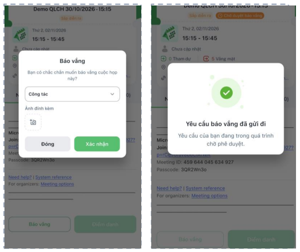

## Các bước thực hiện

:::steps
1. Tại **Chi tiết cuộc họp**.
2. Chọn **“Báo vắng”**.
3. Đính kèm hình ảnh/tài liệu minh chứng (nếu cần).
4. Chọn **“Xác nhận”** để gửi yêu cầu.
:::

## Kết quả

Yêu cầu chuyển đến Người phê duyệt vắng mặt; người tham gia nhận thông báo **“Yêu cầu báo vắng đã gửi”** và theo dõi trạng thái **“Chờ duyệt báo vắng”**.

:::note
Gửi yêu cầu báo vắng **trước thời gian bắt đầu cuộc họp** để được xử lý theo quy trình phê duyệt.
:::
