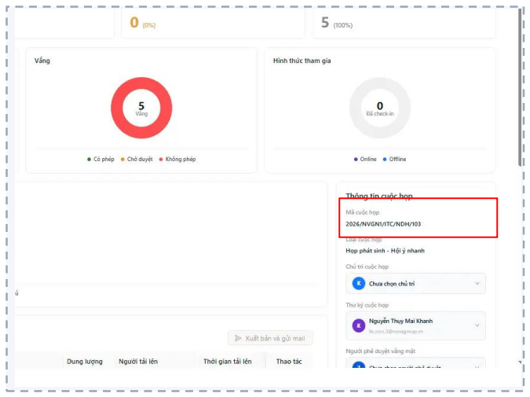

## Cách thực hiện

:::steps
1. Mở **Chi tiết cuộc họp**.
2. Kiểm tra trường **“Mã cuộc họp”**.
3. Sao chép mã cuộc họp.
4. Cập nhật mã vào file Agenda.
5. Vào Outlook gửi lại Agenda.
:::

## Quy tắc tạo mã cuộc họp

| Loại cuộc họp | Thời điểm tạo mã |
|---|---|
| Họp phát sinh / Hội ý nhanh | Tự tạo mã ngay khi đồng bộ. |
| Họp định kỳ | Tự tạo mã **trước 24 giờ**. |

:::tip Cần mã sớm hơn?
Bấm **“Tạo mã cuộc họp”**.
:::
