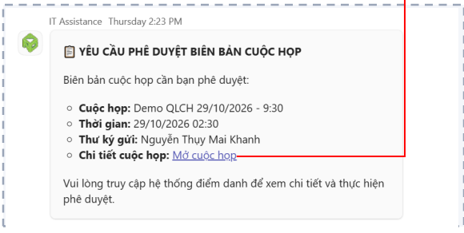
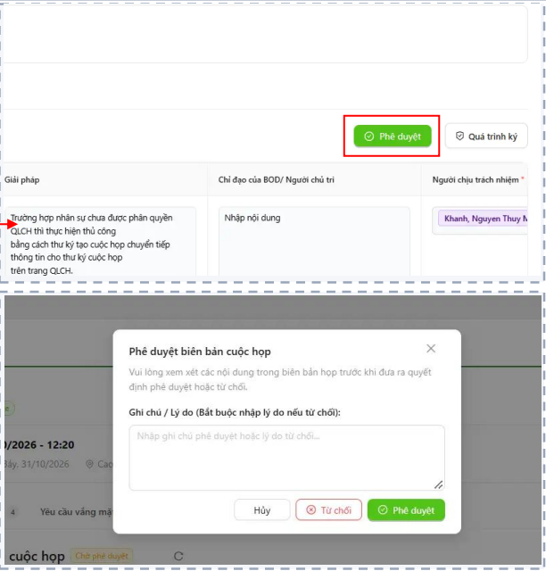

## Các bước thực hiện

:::steps
1. Nhận thông báo yêu cầu phê duyệt biên bản qua **Teams**.
2. Nhấn **“Mở cuộc họp”** để truy cập chi tiết cuộc họp và biên bản.
3. Kiểm tra nội dung biên bản, có thể điều chỉnh trước khi phê duyệt.
4. **Phê duyệt**: xác nhận nội dung biên bản; hoặc **Từ chối**: nhập lý do để thư ký cuộc họp chỉnh sửa lại.
:::

:::success
Biên bản được phê duyệt hoặc trả về thư ký cuộc họp kèm lý do từ chối.
:::
