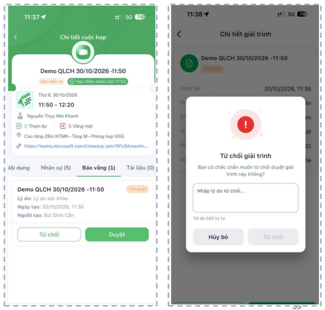

## Các bước thực hiện

:::steps
1. Hệ thống gửi thông báo yêu cầu đến người được chỉ định qua ứng dụng **One Nova**.
2. Người phê duyệt chọn **“Phê duyệt”** hoặc **“Từ chối”**.
3. Hệ thống cập nhật tình trạng cho người mời họp và người tham gia.
:::
