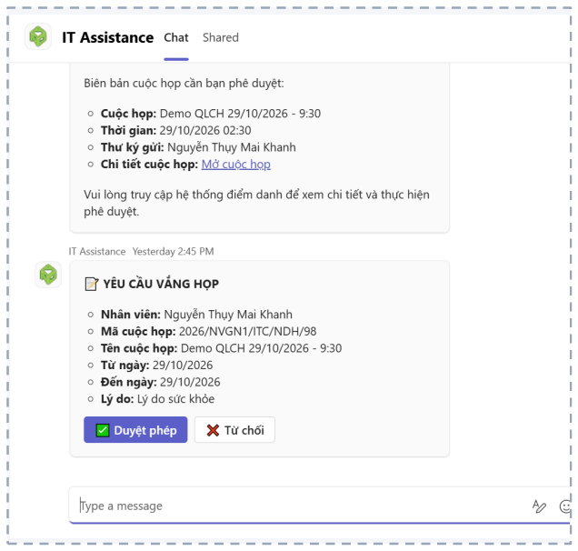

## Các bước thực hiện

:::steps
1. Hệ thống gửi thông báo yêu cầu đến người được chỉ định qua **Teams**.
2. Người phê duyệt xem thông tin yêu cầu.
3. Chọn **“Duyệt phép”** hoặc **“Từ chối”**.
4. Hệ thống cập nhật tình trạng cho người mời họp và người tham gia.
:::

Có thể xử lý trên điện thoại: [Phê duyệt vắng mặt (qua One Nova)](/docs/phe-duyet-vang-mat-qua-one-nova).
