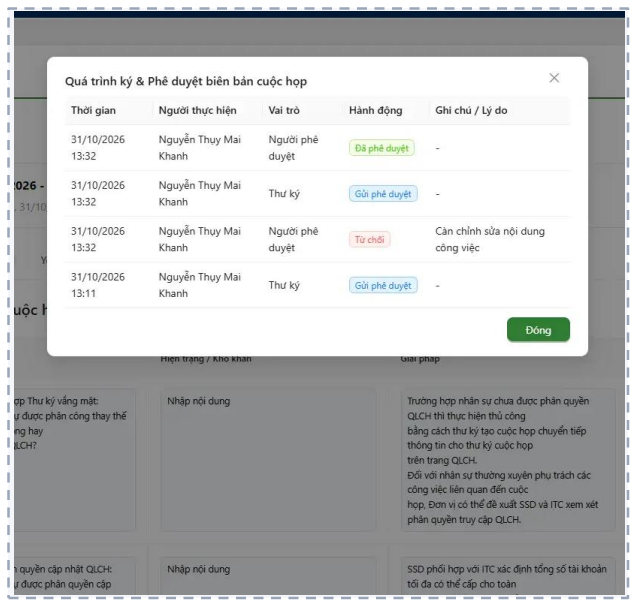

## Các bước thực hiện

:::steps
1. Truy cập **Chi tiết cuộc họp**, chọn tab **Biên bản họp**.
2. Nhấn **“Quá trình ký”**.
3. Theo dõi lịch sử xử lý trong cửa sổ hiển thị.
:::

:::success
Nắm được trạng thái phê duyệt và lý do từ chối để thực hiện bước tiếp theo.
:::
