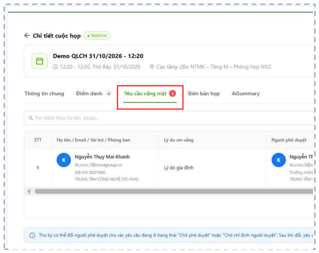

## Các bước thực hiện

:::steps
1. Mở **Chi tiết cuộc họp**, chọn tab **“Yêu cầu vắng mặt”**.
2. Tra cứu danh sách và trạng thái yêu cầu.
3. Dùng tìm kiếm hoặc bộ lọc trạng thái khi cần.
:::

## Kết quả

Hiển thị: người yêu cầu, lý do, người phê duyệt, thời gian gửi/duyệt, ghi chú, trạng thái (**Chờ phê duyệt** / **Đã duyệt** / **Từ chối**).

:::note
Có thể [đổi người phê duyệt](/docs/doi-nguoi-phe-duyet-vang-mat) với yêu cầu “Chờ phê duyệt” hoặc “Chờ chỉ định người duyệt”; yêu cầu sẽ gửi lại đến người duyệt mới.
:::
