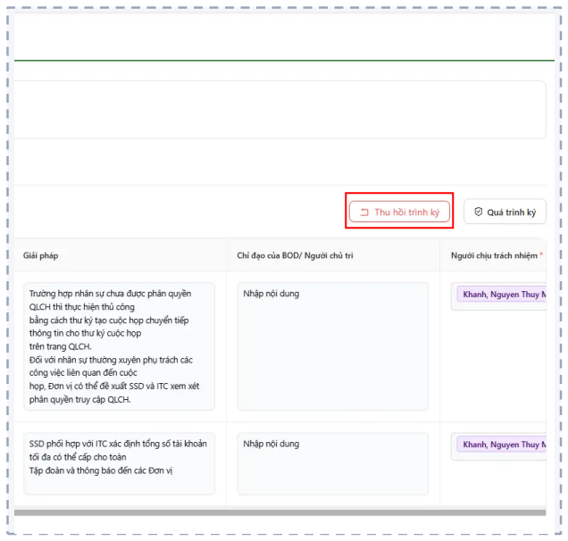

## Các bước thực hiện

:::steps
1. Truy cập **Chi tiết cuộc họp**, chọn tab **Biên bản họp**.
2. Nhấn **“Thu hồi trình ký”**.
3. Chỉnh sửa, bổ sung thông tin theo nhu cầu.
:::

:::success
Biên bản được thu hồi khỏi quy trình trình ký để người mời họp tiếp tục chỉnh sửa.
:::
