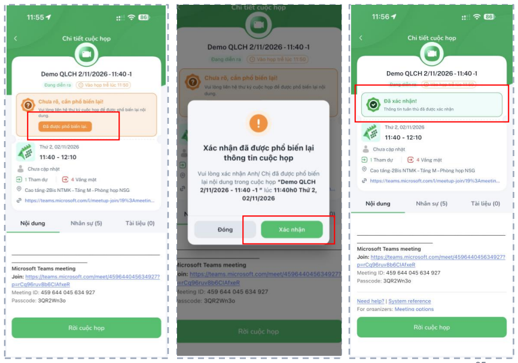

## Các bước thực hiện

:::steps
1. Nhấn **“Đã được phổ biến lại”**.
2. Popup xác nhận hiển thị → nhấn **“Xác nhận”**.
:::

:::success
Trạng thái chuyển thành **“Đã xác nhận”**; lưu thời gian xác nhận để theo dõi/lịch sử.
:::
