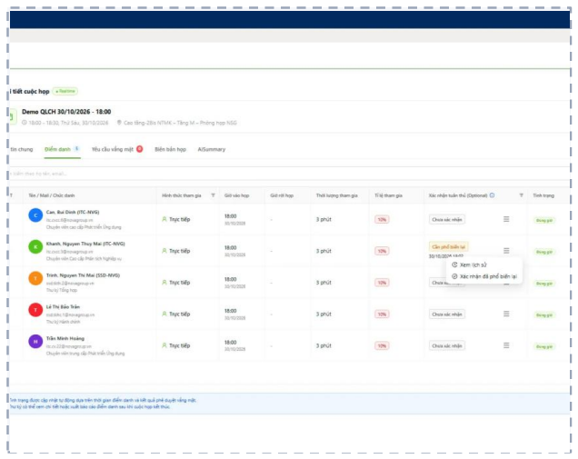

## Các bước thực hiện

:::steps
1. Mở tab **“Điểm danh”**.
2. Tìm người có trạng thái **“Cần phổ biến lại”**.
3. Phổ biến lại thông tin cho người tham gia.
4. Chọn **“Xác nhận đã phổ biến lại”**.
:::

## Kết quả

Hệ thống gắn tag **“Đã phổ biến lại”**; người tham gia vào One Nova bấm **“Xác nhận đã hiểu”** thì trạng thái mới được cập nhật.

:::note
“Đã phổ biến lại” là xác nhận của người mời họp, **không thay thế** việc người tham gia xác nhận đã hiểu. Xem [Xác nhận đã được phổ biến lại](/docs/xac-nhan-da-duoc-pho-bien-lai) (phía người tham gia).
:::
