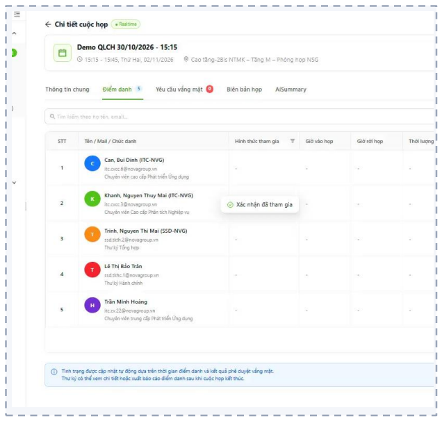

## Các bước thực hiện

:::steps
1. Truy cập **Chi tiết cuộc họp**, chọn tab **Điểm danh**.
2. Nhấp chuột phải vào người tham gia cần xác nhận.
3. Chọn **“Xác nhận đã tham gia”**.
:::

:::success
Trạng thái của người được xác nhận chuyển thành **“Đã vào họp”**.
:::
