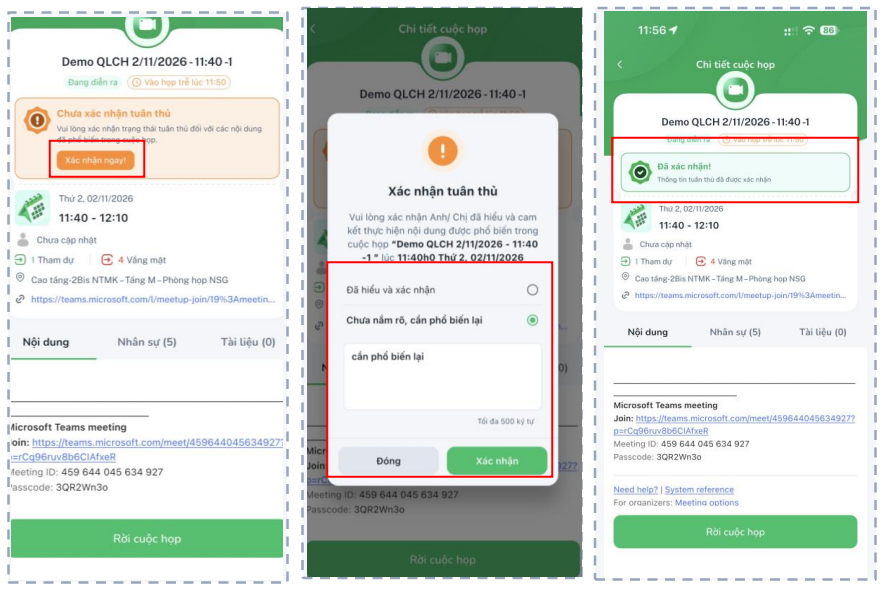

## Các bước thực hiện

:::steps
1. Tại **Chi tiết cuộc họp**, hệ thống hiển thị **“Chưa xác nhận tuân thủ”** và nút **“Xác nhận ngay!”**.
2. Nhấn **“Xác nhận ngay!”**.
3. Chọn **“Đã hiểu và xác nhận”** hoặc **“Chưa nắm rõ, cần phổ biến lại”**.
:::

## Kết quả

| Lựa chọn | Kết quả |
|---|---|
| **Đã hiểu và xác nhận** | Trạng thái chuyển thành “Đã xác nhận”; lưu thời gian xác nhận để theo dõi/lịch sử. |
| **Chưa nắm rõ, cần phổ biến lại** | Trạng thái chuyển thành “Chưa rõ, cần phổ biến lại”, chờ [xác nhận lại](/docs/xac-nhan-da-duoc-pho-bien-lai). |
