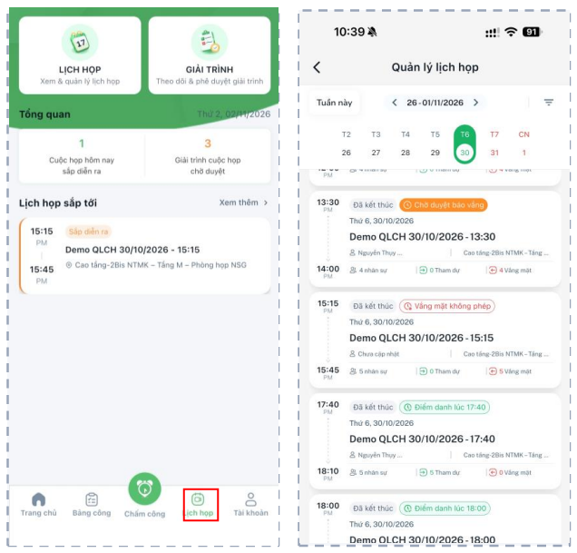

## Các bước thực hiện

:::steps
1. Tại màn hình One Nova, chọn **“Lịch họp”** trên menu.
2. Hệ thống hiển thị danh sách các cuộc họp được mời, phân loại **Đang diễn ra** / **Sắp diễn ra** / **Đã kết thúc**.
:::
