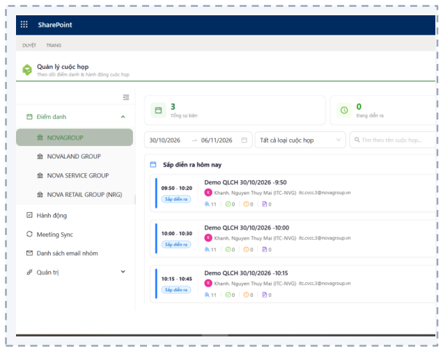

## Các bước thực hiện

:::steps
1. Chọn khoảng thời gian để xem các cuộc họp.
2. Tìm kiếm theo thông tin cuộc họp.
3. Theo dõi trạng thái cuộc họp.
4. Chọn cuộc họp để xem chi tiết và thực hiện nghiệp vụ liên quan.
:::

:::note
QLCH tự động đồng bộ cuộc họp từ Outlook để hiển thị và cập nhật dữ liệu. Hệ thống kiểm tra Outlook định kỳ **5 phút/lần**.
:::
