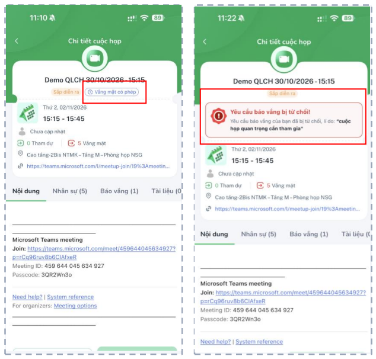

## Các trạng thái hiển thị

| Trạng thái | Ý nghĩa |
|---|---|
| **Vắng mặt có phép** | Yêu cầu được chấp thuận. |
| **Yêu cầu báo vắng bị từ chối** | Kèm lý do từ chối của người phê duyệt. |
| **Chờ duyệt báo vắng** | Yêu cầu chưa được xử lý. |
