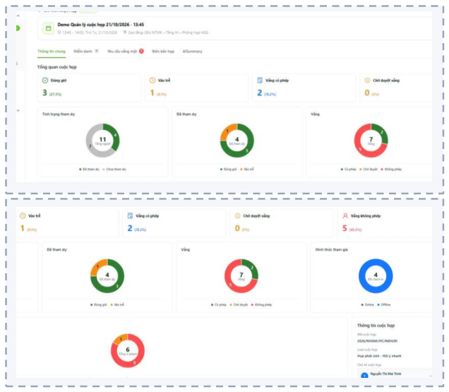

## Thông tin thống kê

| Chỉ số | Ý nghĩa |
|---|---|
| **Đúng giờ** | Đã điểm danh đúng thời gian quy định. |
| **Vào trễ** | Điểm danh sau thời gian quy định. |
| **Vắng có phép** | Yêu cầu vắng đã được phê duyệt. |
| **Chờ duyệt vắng** | Đã gửi yêu cầu nhưng chưa xử lý. |
| **Chưa vào** | Chưa thực hiện điểm danh. |
