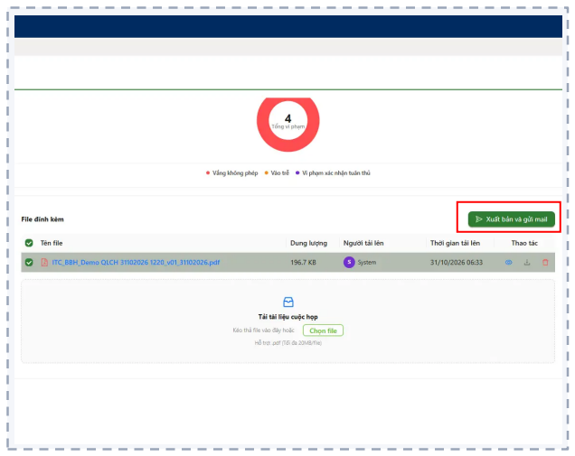

## Các bước thực hiện

:::steps
1. Chọn file Biên bản đã trình ký (hệ thống tự động tạo file sau khi Biên bản họp được duyệt).
2. Tải lên hoặc chọn thêm các file cần xuất bản & gửi mail.
3. Chọn **“Xuất bản & gửi mail”**.
4. Hệ thống xuất bản file và gửi mail đến người tham gia.
:::

## Kết quả

- Mail Biên bản họp gửi đến người được mời.
- File PDF xuất bản vào cuộc họp tương ứng trên One Nova để [xem](/docs/xem-tai-lieu-da-xuat-ban).

:::note
Chỉ hỗ trợ file **PDF**. Có thể chọn nhiều file; hệ thống gửi **01 email duy nhất** đính kèm toàn bộ file đã chọn.
:::
