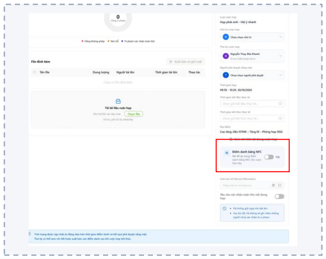

## Các bước thực hiện

:::steps
1. Bật tùy chọn **“Yêu cầu điểm danh bằng NFC”**.
2. Người tham gia chọn hình thức **“Trực tiếp (Offline)”** trên One Nova.
3. Người tham gia quét NFC tại phòng họp để hoàn tất điểm danh.
:::

:::note
Chỉ bật được khi phòng họp đã được khai báo NFC trên hệ thống.
:::
