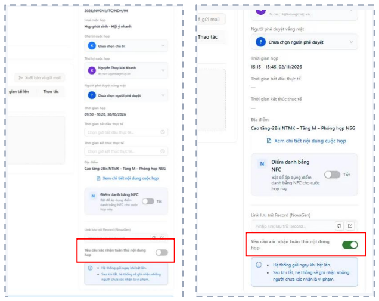

## Các bước thực hiện

:::steps
1. Mở **Chi tiết cuộc họp**.
2. Tại mục **“Yêu cầu xác nhận tuân thủ nội dung họp”**.
3. Bật công tắc yêu cầu xác nhận.
4. Hệ thống kích hoạt yêu cầu cho người tham gia.
:::

## Kết quả

- Hệ thống ghi nhận tình trạng xác nhận từng người.
- Người mời họp theo dõi trên QLCH.
- Người chưa xác nhận được ghi nhận để xử lý theo quy định.

:::warning
Chỉ bật được **một lần**, không bật lại sau khi đã đóng. Khi đóng yêu cầu, người chưa phản hồi bị ghi nhận **vi phạm xác nhận tuân thủ**.
:::
